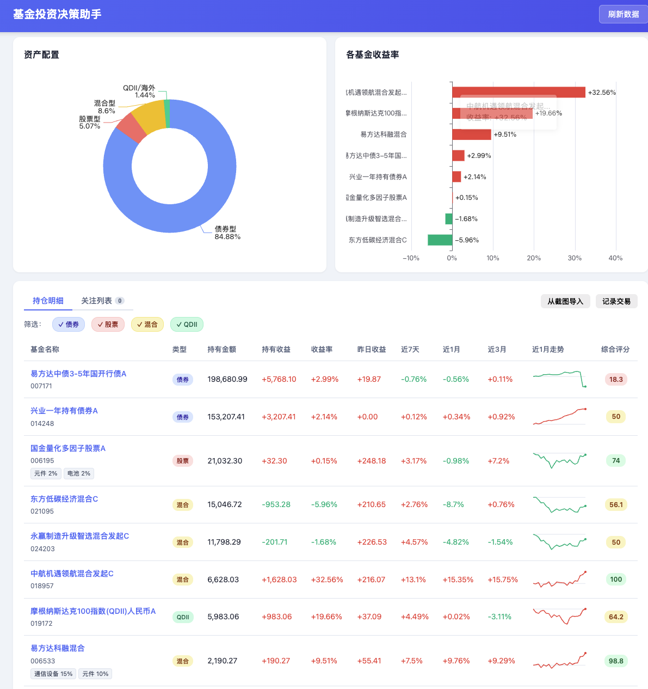
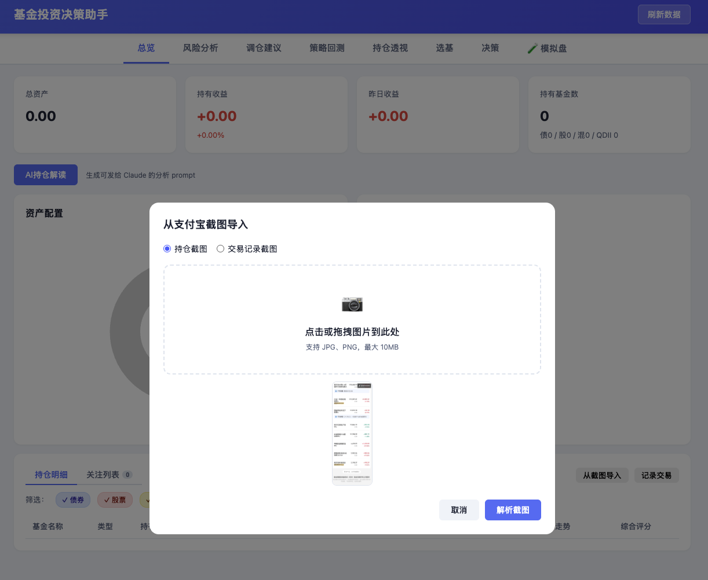
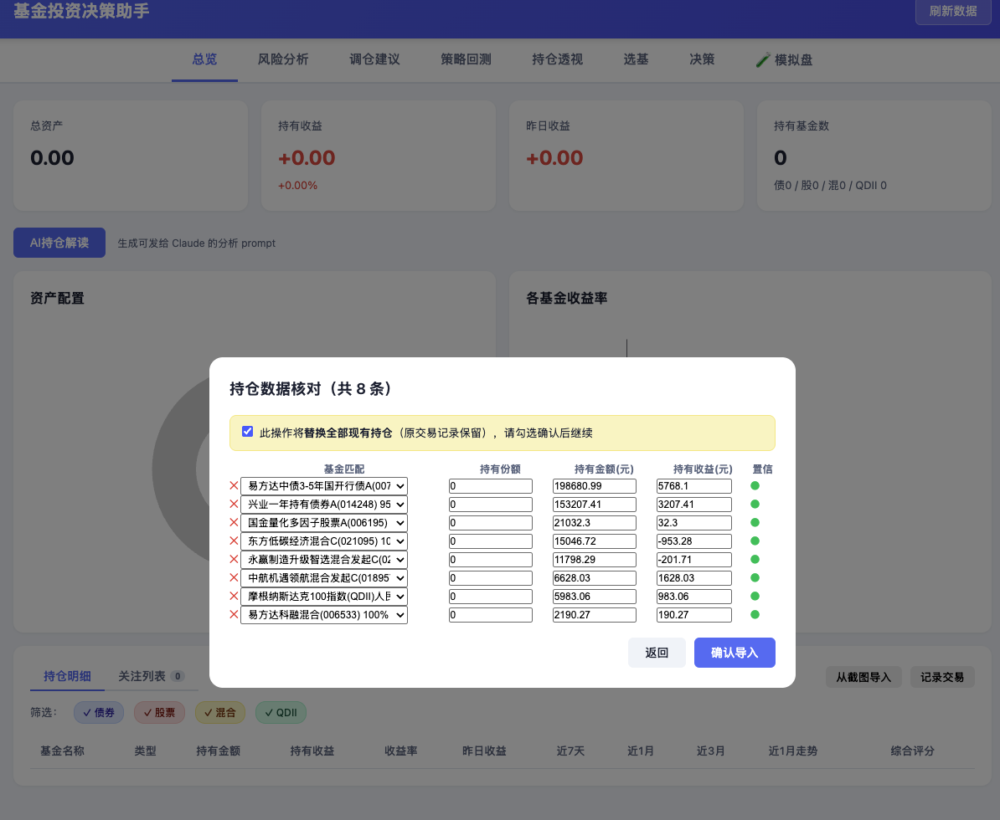
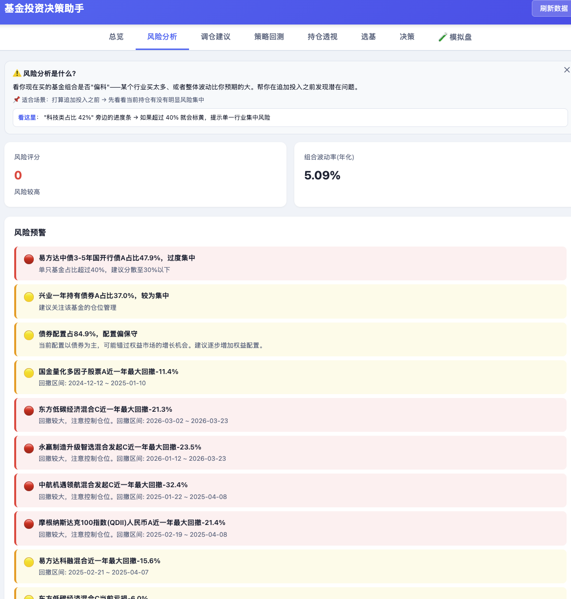
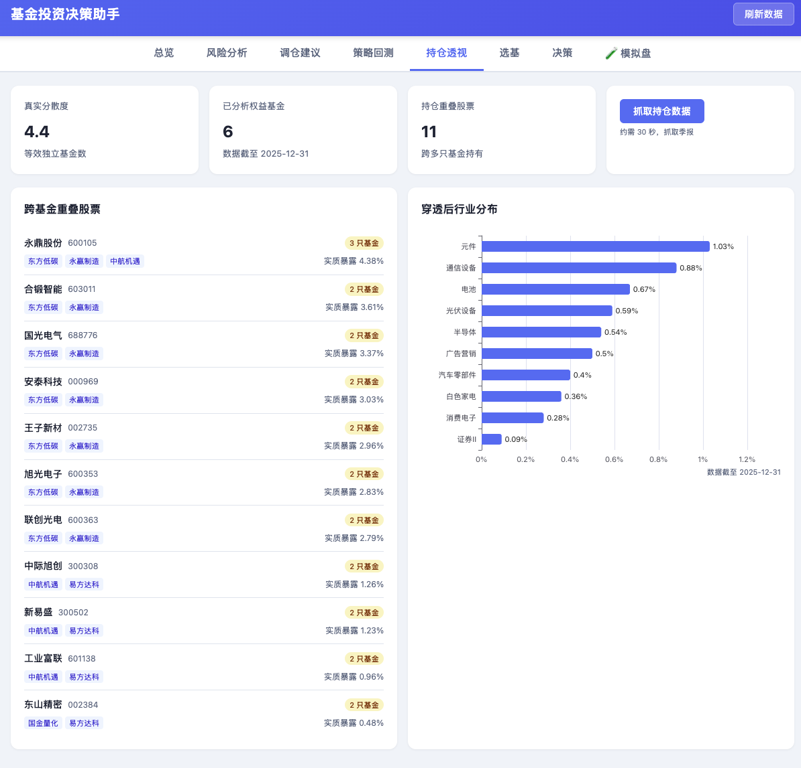
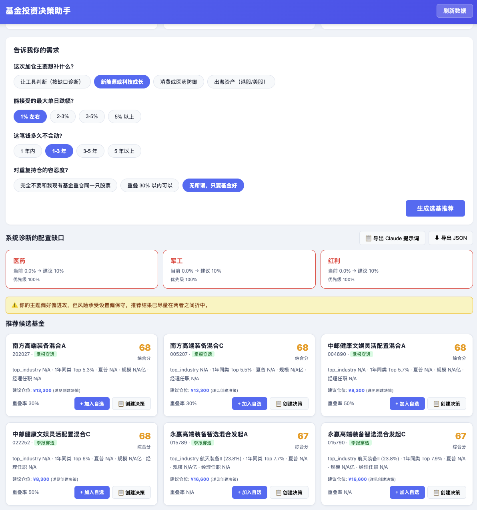
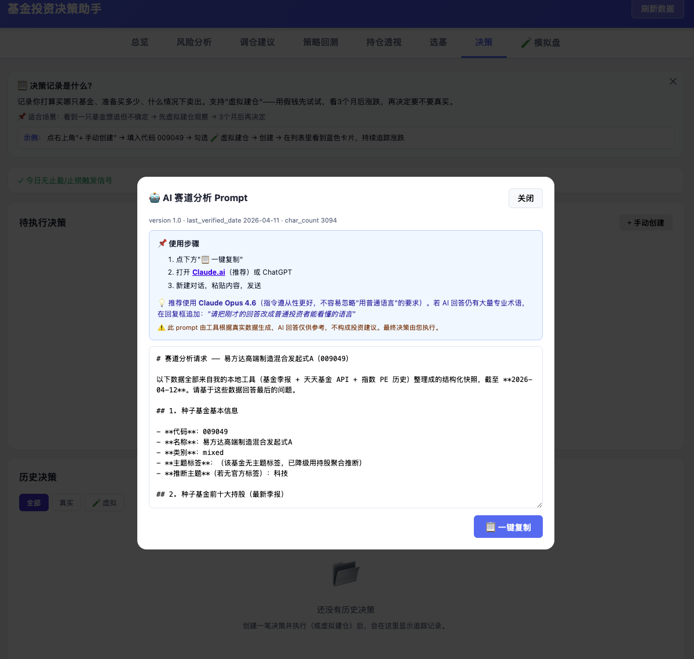
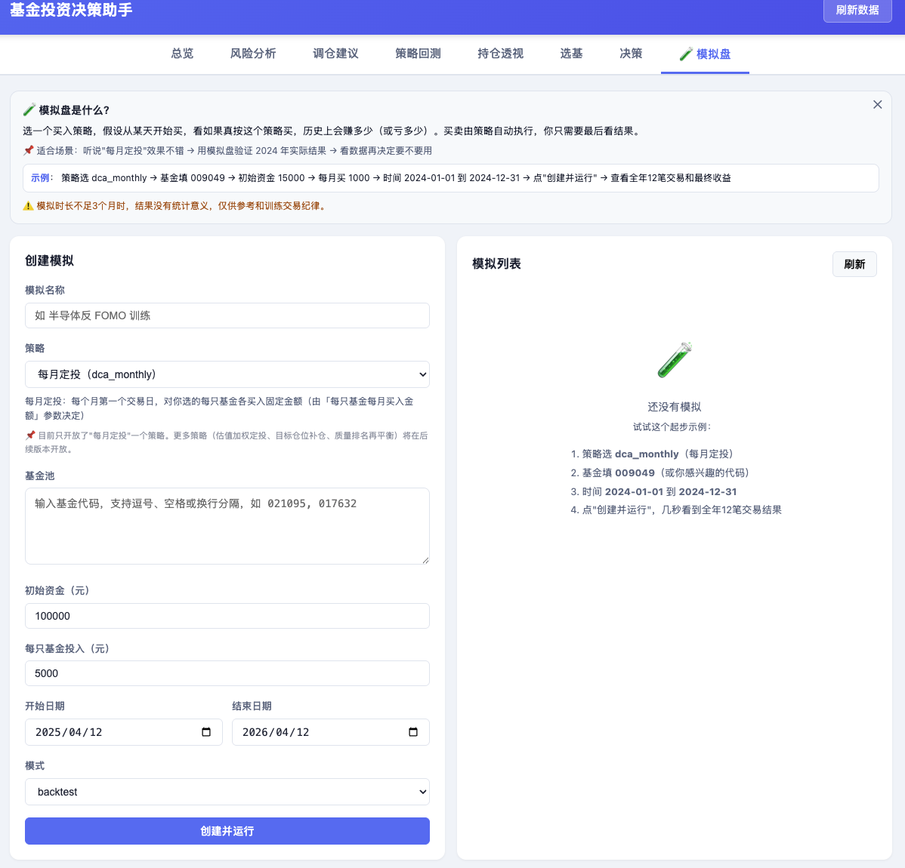
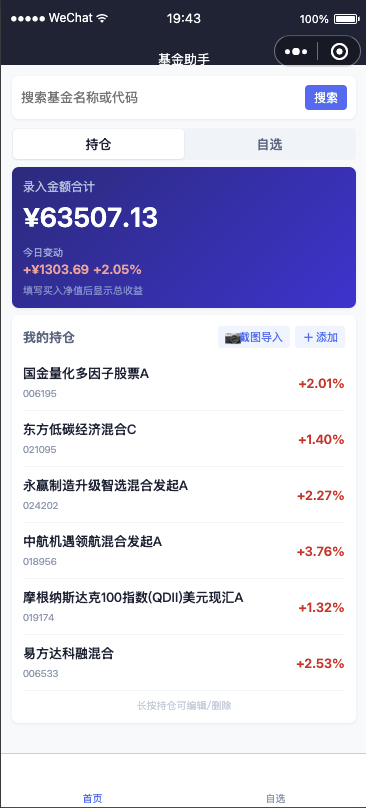
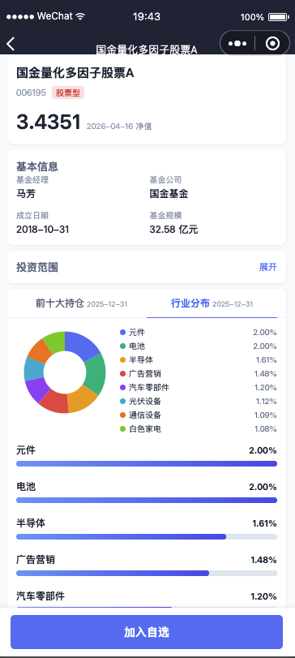

# 散户 sanhu

> 普通人买基金的决策助手。帮你看懂、帮你比较、帮你模拟 —— 最终由你决定。
>
> **单文件程序，双击即用** —— 原生 Windows / macOS / Linux 可执行文件，无需安装 Python 或任何依赖，初始数据已内置，首启无需联网。Python 旧版见 `final-python` tag。

---

## 这是什么

支付宝里买了几只基金，但不知道买得好不好？每次追涨杀跌，事后总是后悔？

sanhu 是一个**本地运行的基金投资辅助工具**，连接公开数据，帮普通投资者做三件事：

1. **看懂自己的持仓** — 当前盈亏、仓位分布、各基金综合评分
2. **做决策前先模拟** — 虚拟建仓观察，策略回测验证，不花真钱先试
3. **生成 AI 分析 Prompt** — 把你的真实持仓数据整理成结构化 Prompt，发给 Claude / ChatGPT 获取分析

工具不替你下单，不接入任何 AI 后端，不存储你的账户信息。

---

## 快速开始

sanhu 是一个**单文件程序**：下载对应平台的可执行文件，双击运行即可——无需安装 Python、Node 或数据库。

### 下载

前往 **[Releases](https://github.com/pakoo/sanhu/releases/latest)** 下载你的平台对应文件：

| 平台 | 文件 |
|---|---|
| Windows (Intel/AMD) | `sanhu-windows-amd64.zip`（解压后双击 `sanhu.exe`） |
| Windows (ARM) | `sanhu-windows-arm64.zip` |
| macOS (Apple 芯片) | `sanhu-darwin-arm64.tar.gz` |
| macOS (Intel) | `sanhu-darwin-amd64.tar.gz` |
| Linux (x86_64) | `sanhu-linux-amd64.tar.gz` |
| Linux (ARM64) | `sanhu-linux-arm64.tar.gz` |

### 运行

- **Windows**：解压后双击 `sanhu.exe`
- **macOS / Linux**：解压后在终端运行 `./sanhu`（macOS 首次可能提示"无法验证开发者"，右键 → 打开 → 确认）

然后浏览器打开 [http://localhost:8000](http://localhost:8000)。

> **首次启动**会把内置的初始数据（基金档案 / 估值历史）解压灌库，**全程不联网**。详见 [首次启动流程](docs/first-run.md)。
>
> 数据库存在**可执行文件同级的 `data/` 目录**里，换目录启动也不会丢数据；备份或搬迁直接拷这个目录。

### 从源码构建（开发者）

```bash
git clone https://github.com/pakoo/sanhu.git
cd sanhu
go build -o sanhu ./cmd/sanhu
./sanhu
```

---

## 录入持仓

打开支付宝 → 基金账户 → 持有页面，照着上面的数字逐只填进来即可。

**第一步：点「更新持仓」，按代码录入**

填三个数：**基金代码 / 持有金额 / 持有收益**（收益可留空）。
填完代码会自动带出基金名称和类型 —— 代码填错会当场提示，不会录进一只查不到的基金。

**第二步：确认列表，提交**

逐只添加到暂存列表，核对无误后点「确认更新」。提交时会自动获取这些基金的档案和历史净值，
所以第一次录入需要联网，视基金数量约几秒到十几秒。

**第三步：总览一目了然**



> **为什么推荐手动录入**：只有三个数字，一只基金十几秒；而且录进去的数据是准的。
> 相比之下截图识别依赖第三方 OCR 服务，识别错了还得逐行核对修正。

<details>
<summary>另有：支付宝截图识别（试验功能）</summary>

上传支付宝持仓页截图，OCR 自动提取基金名称、持有金额、持有收益，核对后导入。




**为什么标为试验功能**：它依赖 OCR.space 的免费额度，额度耗尽或服务变更时会识别失败；
识别结果也需要人工核对（基金名称容易串行、金额容易漏小数点）。当作省事的辅助手段可以，
但**以它为主要录入方式并不可靠**。

</details>

---

## 功能展示

### 风险分析

自动计算持仓波动率、相关系数热力图，多级预警提示集中风险。



### 持仓透视

穿透基金包装，看底层持股重叠情况和真实行业分布。



### 智能选基

诊断当前配置缺口，问卷式引导，从 8000+ 只基金中推荐候选，附综合评分和建议仓位。



### AI 持仓解读

一键生成结构化持仓分析 Prompt，复制后发给 Claude / ChatGPT 获取专业解读。数据不离开本机。



### 模拟盘

设置 DCA 定投等策略，用历史真实净值验证效果，或从今天开始前向模拟。



---

## 功能一览

| 模块 | 功能 |
|---|---|
| **持仓总览** | 总市值、盈亏、资产配置饼图、各基金7天/1月/3月走势 |
| **关注列表** | 自选基金跟踪，30天走势迷你图，综合评分徽章 |
| **风险分析** | 持仓相关性热力图、波动率分析、多级预警 |
| **持仓透视** | 穿透基金看底层重叠持股和行业暴露 |
| **调仓建议** | 对照目标配置，自动识别超配/低配 |
| **选基向导** | 问答式引导，从 8000+ 基金中筛选候选 |
| **策略模拟** | DCA定投等策略，历史回测 + 前向模拟 |
| **决策记录** | 记录买入计划，支持虚拟建仓（假钱观察真结果） |
| **AI 入口** | 生成数据丰富的持仓分析 Prompt |
| **市场估值** | 沪深300 / 中证500 PE百分位实时显示 |

---

## 使用手册

详细的功能说明和操作教程请查看 **[使用手册](docs/guide.md)**，涵盖所有功能模块的用法和常见问题。

---

## 技术栈

- **后端**：Go（单二进制，前后端一起打包，无运行时依赖）+ SQLite
- **前端**：原生 HTML/CSS/JS（无框架依赖），通过 `embed` 编译进二进制
- **图表**：ECharts

数据全部本地存储，不上传任何个人信息。

---

## 项目设计原则

- **工具辅助，用户执行**：工具帮你分析，买卖由你决定，不接入任何自动交易接口
- **可达性不降级专业深度**：术语旁有 ⓘ 说明，但原始数据不被简化替换
- **无后端 AI**：不调用任何 LLM API，AI 功能通过生成 Prompt 让用户自己去问

---

## 数据说明

### 初始数据（内置）

初始参考数据（gzip 压缩约 1.2MB）随二进制一起编译进程序，首次启动解压灌库，全程离线：

| 数据表 | 内容 | 行数 |
|---|---|---|
| `fund_profile` | 基金档案：类型、风格、主题标签、规模 | ~28,000 条 |
| `fund_peer_ranks` | 同类百分位排名 | ~18,000 条 |
| `index_pe_history` | 沪深300 / 中证500 近10年 PE/PB 历史 | ~9,700 条 |
| `nav_history` | 部分基金净值历史 | ~6,300 条 |
| `fund_holdings` | 部分基金持仓穿透数据 | ~200 条 |

> `fund_profile` 中的分类数据大部分由本地规则推断生成（`profile_source: inferred`），并非全部来自实时接口。

### 运行时更新

点击右上角「刷新数据」后，工具会通过公开接口补充：
- 你关注和持仓的基金最新净值
- 市场 PE/PB 估值数据

净值数据**按需拉取**（只拉你关注的基金），不会全量下载全市场数据。

### 隐私说明

所有数据保存在本机 `data/` 目录的 SQLite 文件中，不上传任何个人信息或持仓数据。

---

## 更新日志

### v2.0（2026-06）

**后端全面重写为 Go**

- 后端从 Python + FastAPI 迁移到 Go，前后端打包为**单个可执行文件**，下载即用，无需安装 Python 或任何依赖
- 初始数据**内置于二进制**，首次启动解压即用，无需联网
- 内置跨平台编译（Windows / macOS / Linux）与自动更新
- 修复迁移脚本与代码 schema 不一致的问题，全新安装可直接运行
- Python 旧版保留在 `final-python` tag

### v1.1（2026-04）

**功能优化**

- **OCR 引擎替换（#1）**：将截图识别从 easyocr 切换至 [OCR.space](https://ocr.space) 云端 API
  - 安装体积从 ~724MB 降至 ~150MB，减少约 80%
  - 移除 PyTorch / scipy / opencv 大型依赖，仅保留轻量 HTTP 调用
  - 中文识别效果与原方案相当，支持支付宝持仓截图逐行输出格式

- **Windows 编码兼容（#2）**：修复 Windows cmd.exe（cp936）环境下的乱码和崩溃问题
  - `install.bat` / `start.bat` 新增 `PYTHONIOENCODING=utf-8` 环境变量
  - 替换 `scripts/init_db.py` 中的 emoji 状态符（`✓ ✗ ○` → `[OK] [--] [-]`），消除 `UnicodeEncodeError`
  - 替换 `install.bat` 中的 emoji 提示符，避免 cp936 控制台解码失败

---

## 常见问题

**macOS 提示"无法验证开发者" / "已损坏"**

未签名的二进制被 Gatekeeper 拦截。右键点击 → 打开 → 确认；或终端运行 `xattr -d com.apple.quarantine ./sanhu`。

**想换一份初始数据**

初始数据已内置，正常情况无需任何配置。若要改用自建/内网的数据集，设置环境变量 `SANHU_SEED_URL` 指向一个 `seed.sql.gz`，首启空库时会改从该地址拉取（覆盖内置数据）。

**想把数据库放到别处**

默认在可执行文件同级的 `data/`。设置 `SANHU_DATA_DIR` 可指定任意目录。

**端口 8000 被占用**

设置环境变量 `SANHU_PORT` 改用其它端口，如 `SANHU_PORT=8090`。

**截图上传后提示"未能识别到基金数据"**

确认上传的是支付宝「基金 → 持有」列表页截图（不是详情页或其他 App），且图片清晰、文字未被截断。

**更多问题**

详见 [使用手册](docs/guide.md) 或扫码加微信反馈。

---

## 📱 微信小程序版（开发中）

移动端版本正在开发中，功能将大部分对齐桌面版，随时随地查看持仓、做决策。

<table>
  <tr>
    <td align="center"></td>
    <td align="center"></td>
  </tr>
</table>

感兴趣参与测试的朋友，扫下方二维码加微信联系：


---

## 联系作者

有任何问题、建议或想法，欢迎扫码加微信交流：


---

## License

MIT
