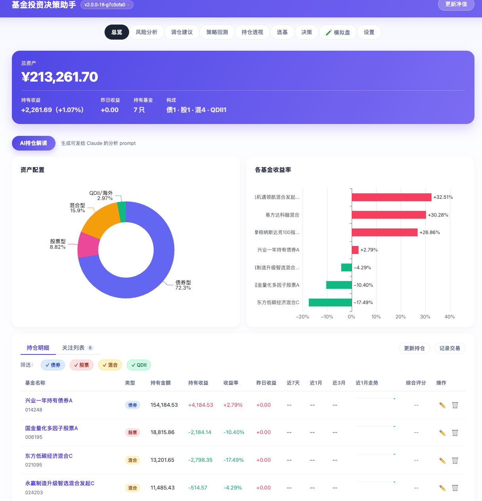
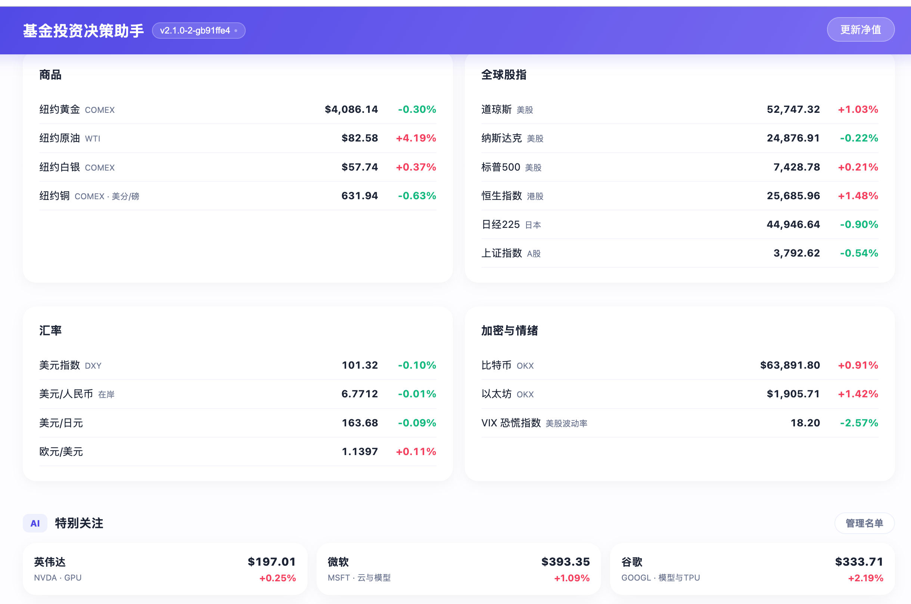
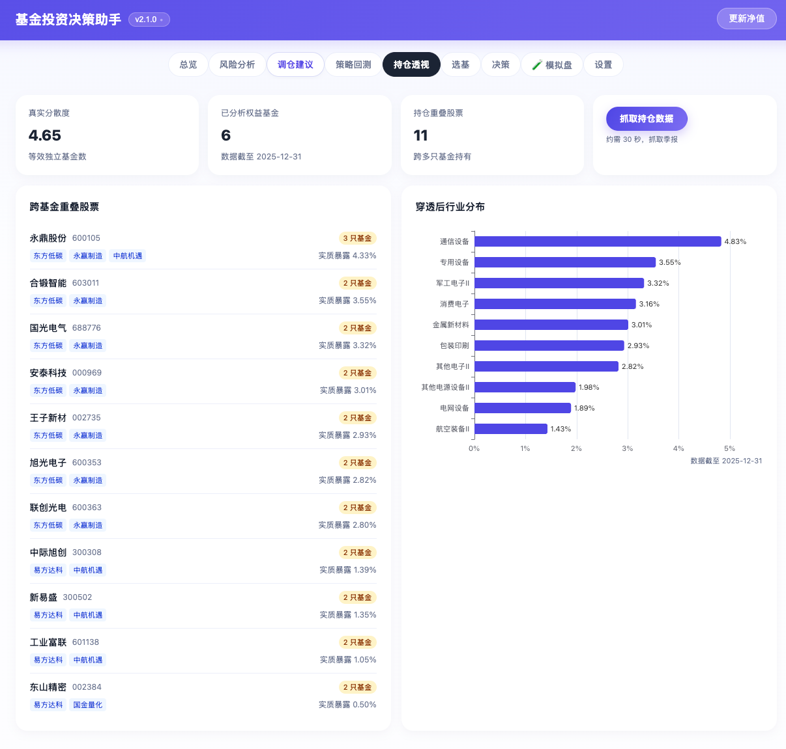
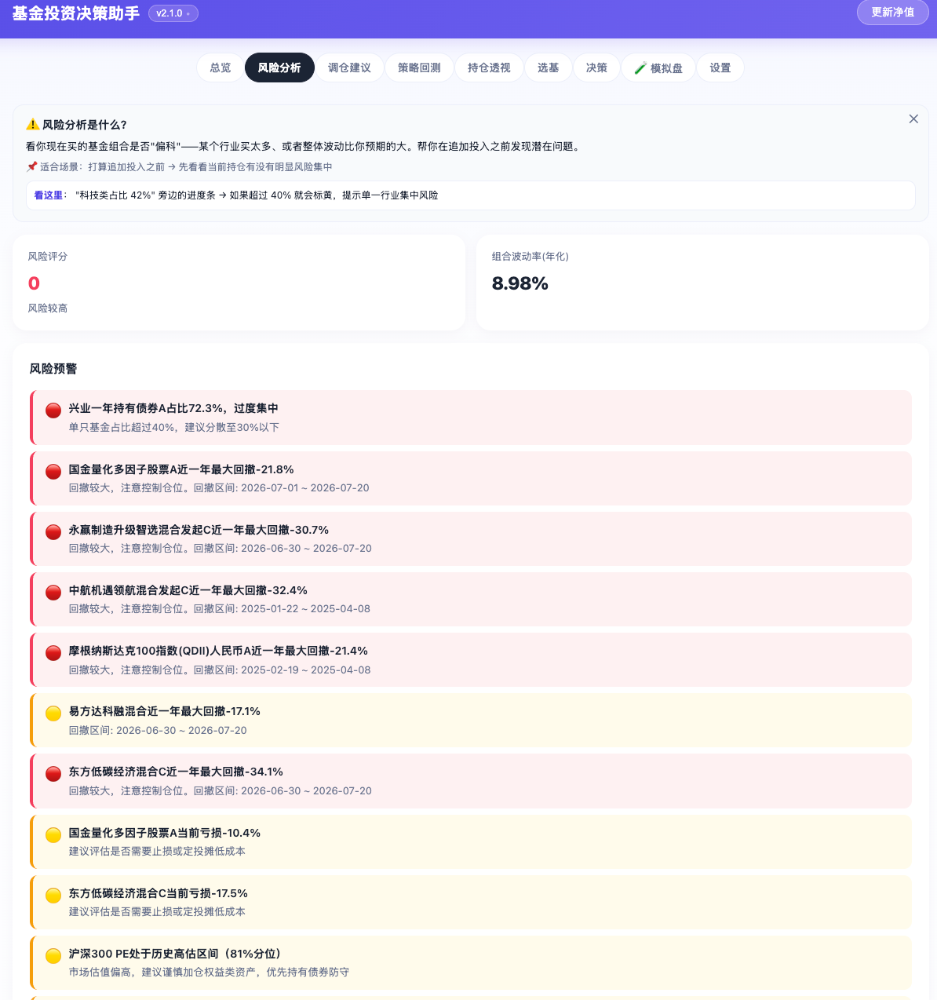
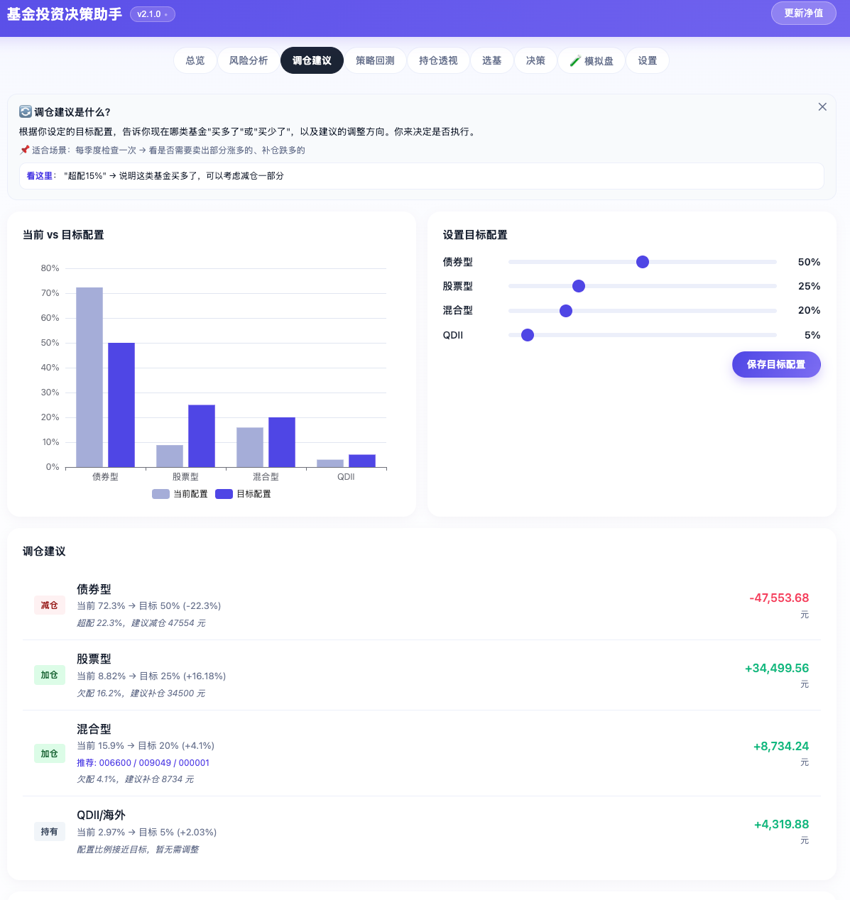

# 散户 sanhu

> 普通人买基金的决策助手。帮你看懂、帮你比较、帮你模拟 —— 最终由你决定。
>
> **单文件程序，双击即用** —— 原生 Windows / macOS / Linux 可执行文件，无需安装 Python 或任何依赖，初始数据已内置，首启无需联网。Python 旧版见 `final-python` tag。



---

## 这是什么

支付宝里买了几只基金，但不知道买得好不好？每次追涨杀跌，事后总是后悔？

sanhu 是一个**本地运行的基金投资辅助工具**，连接公开数据，帮普通投资者做三件事：

1. **看懂自己的持仓** — 当前盈亏、仓位分布、各基金综合评分
2. **做决策前先模拟** — 虚拟建仓观察，策略回测验证，不花真钱先试
3. **生成 AI 分析 Prompt** — 把你的真实持仓数据整理成结构化 Prompt，发给 Claude / ChatGPT 获取分析
4. **盯住市场关键信号** — 黄金/原油/美元指数/全球股指/汇率/加密/VIX 一屏看全，另有 AI 板块专区

工具不替你下单，不接入任何 AI 后端，不存储你的账户信息。

---

## 快速开始

sanhu 是一个**单文件程序**。整个安装过程就三步：**下载 → 解压 → 双击**。不需要装 Python、Node、数据库，也不需要联网初始化。

### 第一步：下载

前往 **[Releases 页面](https://github.com/pakoo/sanhu/releases/latest)**，按你的电脑选一个：

| 你的电脑 | 下载这个文件 | 不确定的话 |
|---|---|---|
| **macOS**（2020 年后的 Mac，M1/M2/M3/M4 芯片） | `sanhu-darwin-arm64.zip` | 点左上角  → 关于本机，看到「芯片 Apple M…」就选这个 |
| **macOS**（2020 年前的 Intel Mac） | `sanhu-darwin-amd64.zip` | 关于本机里写「处理器 Intel…」就选这个 |
| **Windows**（绝大多数电脑） | `sanhu-windows-amd64.zip` | 不确定就选这个，市面上 95% 的 Windows 是它 |
| **Windows**（ARM 笔记本，如 Surface Pro X） | `sanhu-windows-arm64.zip` | 设置 → 系统 → 系统信息里写「基于 ARM」才选这个 |
| **Linux**（x86_64） | `sanhu-linux-amd64.tar.gz` | 终端跑 `uname -m` 显示 `x86_64` |
| **Linux**（ARM64，如树莓派） | `sanhu-linux-arm64.tar.gz` | `uname -m` 显示 `aarch64` |

### 第二步：解压并启动

<details open>
<summary><b>🍎 macOS 的完整步骤</b></summary>

1. 双击下载好的 `.zip`，得到 **`sanhu.app`**
2. 把 `sanhu.app` 拖进「**应用程序**」文件夹（放桌面也行，位置随意）
3. **双击 `sanhu.app`** —— 浏览器会自动打开，看到界面就成了

**首次打开会被系统拦一下**，提示「无法打开，因为无法验证开发者」。这是因为本软件没有购买 Apple 的开发者签名（每年 $99），不是有病毒：

- **右键**点 `sanhu.app` → 选「**打开**」→ 弹窗里再点一次「**打开**」
- 如果系统较新没给这个选项：打开「**系统设置**」→「**隐私与安全性**」→ 往下滚，会看到「已阻止 sanhu」→ 点「**仍要打开**」

这一步只需做一次，之后双击就能开。

**退出程序**：Dock 里右键图标 →「退出」，或按 `Cmd + Q`。

</details>

<details open>
<summary><b>🪟 Windows 的完整步骤</b></summary>

1. 右键下载好的 `.zip` → 「**全部解压缩**」，得到 **`sanhu.exe`**
2. 把它放进一个**固定的文件夹**，比如 `D:\sanhu\`
   （⚠️ 别留在「下载」文件夹里直接跑 —— 你的持仓数据会存在 exe 旁边的 `data` 文件夹，下载文件夹容易被清理）
3. **双击 `sanhu.exe`** —— 会弹出一个黑色命令行窗口（正常，程序在里面跑），然后浏览器自动打开

**首次运行会看到蓝色提示**「Windows 已保护你的电脑」。同样是因为没买代码签名证书：

- 点提示里的「**更多信息**」→ 再点「**仍要运行**」

这一步只需做一次。

**退出程序**：关掉那个黑色命令行窗口即可（或在窗口里按 `Ctrl + C`）。

</details>

<details>
<summary><b>🐧 Linux 的完整步骤</b></summary>

```bash
tar -xzf sanhu-linux-amd64.tar.gz
chmod +x sanhu
./sanhu
```

浏览器会自动打开；若无图形界面，手动访问 `http://localhost:8000`。

</details>

### 第三步：录入你的持仓

打开后是空的，点「**更新持仓**」按基金代码把持仓填进去（三个数字，一只基金十几秒）。详见下面的[录入持仓](#录入持仓)。

---

### 常用设置

程序默认监听 `8000` 端口。如果这个端口被占用了，程序会明确告诉你，换一个即可：

| 平台 | 换端口启动 |
|---|---|
| macOS | `SANHU_PORT=8123 /Applications/sanhu.app/Contents/MacOS/sanhu` |
| Windows（PowerShell） | `$env:SANHU_PORT=8123; .\sanhu.exe` |
| Linux | `SANHU_PORT=8123 ./sanhu` |

| 环境变量 | 作用 | 默认值 |
|---|---|---|
| `SANHU_PORT` | 服务端口 | `8000` |
| `SANHU_DATA_DIR` | 数据库存放目录 | 见下表 |
| `SANHU_NO_BROWSER` | 设为 `1` 则不自动打开浏览器 | 未设置 |

### 数据存在哪

| 平台 | 位置 |
|---|---|
| macOS | `~/Library/Application Support/sanhu/` |
| Windows | `sanhu.exe` 同级的 `data\` 文件夹 |
| Linux | 可执行文件同级的 `data/` 文件夹 |

备份或换电脑，把这个目录整个拷走即可。**升级新版本不会动到它。**

### 从源码构建（开发者）

```bash
git clone https://github.com/pakoo/sanhu.git
cd sanhu
go build -o sanhu ./cmd/sanhu
./sanhu
```

需要 Go 1.22+。macOS 想打成可双击的 `.app`：`./scripts/build-macos-app.sh`。

---

## 录入持仓

打开支付宝 → 基金账户 → 持有页面，照着上面的数字逐只填进来即可。

**第一步：点「更新持仓」，按代码录入**

填三个数：**基金代码 / 持有金额 / 持有收益**（收益可留空）。
填完代码会自动带出基金名称和类型 —— 代码填错会当场提示，不会录进一只查不到的基金。

**第二步：确认列表，提交**

逐只添加到暂存列表，核对无误后点「确认更新」。提交时会自动获取这些基金的档案和历史净值，
所以第一次录入需要联网，视基金数量约几秒到十几秒。

**第三步：总览一目了然**

录完就能看到总资产、盈亏、资产配置和每只基金的表现（截图见文首）。

> **为什么推荐手动录入**：只有三个数字，一只基金十几秒；而且录进去的数据是准的。
> 相比之下截图识别依赖第三方 OCR 服务，识别错了还得逐行核对修正。

<details>
<summary>另有：支付宝截图识别（试验功能）</summary>

入口在「**设置**」Tab → 数据录入 → 打开截图识别。
上传支付宝持仓页截图，OCR 自动提取基金名称、持有金额、持有收益，核对后导入。

**为什么标为试验功能**：它依赖 OCR.space 的免费额度，额度耗尽或服务变更时会识别失败；
识别结果也需要人工核对（基金名称容易串行、金额容易漏小数点）。当作省事的辅助手段可以，
但**以它为主要录入方式并不可靠**。

</details>

---

## 功能展示

### 市场板块

黄金 / 原油 / 美元指数 / 全球股指 / 汇率 / 加密货币 / VIX 一屏看全，顶部「今日信号」只挑异动（涨跌超 ±1%），安静的日子它就是空的。下方是 **AI 特别关注区** —— 美股核心公司与 A 股产业链，名单可自己增删。



### 持仓透视

穿透基金包装，看底层持股重叠情况和真实行业分布。「等效独立基金数」告诉你手里 6 只基金实际上相当于几只 —— 买了一堆却买了同一批股票，这里能看出来。



### 风险分析

自动计算持仓波动率、单只集中度、最大回撤，多级预警提示风险点。每条预警都带具体数字和区间，不是笼统的「注意风险」。



### 调仓建议

设定目标配置后，自动算出每个类别超配/低配多少、建议加减多少钱，并推荐具体基金。执行与否由你决定。



### 还有

- **智能选基** —— 诊断配置缺口，问卷式引导推荐候选
- **AI 持仓解读** —— 一键生成结构化 Prompt，复制后发给 Claude / ChatGPT，数据不离开本机
- **模拟盘** —— DCA 定投等策略的历史回测与前向模拟
- **决策记录** —— 记录买入计划，支持虚拟建仓（假钱观察真结果）

---

## 功能一览

| 模块 | 功能 |
|---|---|
| **持仓总览** | 总市值、盈亏、资产配置饼图、各基金7天/1月/3月走势 |
| **关注列表** | 自选基金跟踪，30天走势迷你图，综合评分徽章 |
| **风险分析** | 持仓相关性热力图、波动率分析、多级预警 |
| **持仓透视** | 穿透基金看底层重叠持股和行业暴露 |
| **调仓建议** | 对照目标配置，自动识别超配/低配 |
| **选基向导** | 问答式引导，从 8000+ 基金中筛选候选 |
| **策略模拟** | DCA定投等策略，历史回测 + 前向模拟 |
| **决策记录** | 记录买入计划，支持虚拟建仓（假钱观察真结果） |
| **AI 入口** | 生成数据丰富的持仓分析 Prompt |
| **市场估值** | 沪深300 / 中证500 PE百分位实时显示 |
| **市场板块** | 全球商品/股指/汇率/加密/VIX + AI 公司专区，今日信号自动筛异动 |

---

## 使用手册

详细的功能说明和操作教程请查看 **[使用手册](docs/guide.md)**，涵盖所有功能模块的用法和常见问题。

---

## 技术栈

- **后端**：Go（单二进制，前后端一起打包，无运行时依赖）+ SQLite
- **前端**：原生 HTML/CSS/JS（无框架依赖），通过 `embed` 编译进二进制
- **图表**：ECharts

数据全部本地存储，不上传任何个人信息。

---

## 项目设计原则

- **工具辅助，用户执行**：工具帮你分析，买卖由你决定，不接入任何自动交易接口
- **可达性不降级专业深度**：术语旁有 ⓘ 说明，但原始数据不被简化替换
- **无后端 AI**：不调用任何 LLM API，AI 功能通过生成 Prompt 让用户自己去问

---

## 数据说明

### 初始数据（内置）

初始参考数据（gzip 压缩约 1.2MB）随二进制一起编译进程序，首次启动解压灌库，全程离线：

| 数据表 | 内容 | 行数 |
|---|---|---|
| `fund_profile` | 基金档案：类型、风格、主题标签、规模 | ~28,000 条 |
| `fund_peer_ranks` | 同类百分位排名 | ~18,000 条 |
| `index_pe_history` | 沪深300 / 中证500 近10年 PE/PB 历史 | ~9,700 条 |
| `nav_history` | 部分基金净值历史 | ~6,300 条 |
| `fund_holdings` | 部分基金持仓穿透数据 | ~200 条 |

> `fund_profile` 中的分类数据大部分由本地规则推断生成（`profile_source: inferred`），并非全部来自实时接口。

### 运行时更新

点击右上角「刷新数据」后，工具会通过公开接口补充：
- 你关注和持仓的基金最新净值
- 市场 PE/PB 估值数据

净值数据**按需拉取**（只拉你关注的基金），不会全量下载全市场数据。

### 隐私说明

所有数据保存在本机 `data/` 目录的 SQLite 文件中，不上传任何个人信息或持仓数据。

---

## 更新日志

### v2.2（2026-07）

- **新增市场板块**：黄金/原油/美元指数/全球股指/汇率/加密货币/VIX 一屏看全，
  「今日信号」自动筛出涨跌超 ±1% 的异动；**AI 特别关注区**含美股核心公司与 A 股产业链，名单可自行增删
- **全站视觉改版**（柔和理财风格）：总资产改为渐变 Hero 卡，导航改药丸式，全站统一圆角与阴影
- **新增设置页**：截图识别入口、风险偏好、版本与数据目录
- **录入流程改造**：空持仓时给出引导而非四个 0；填代码即时校验并带出基金名称；
  录入后自动补齐档案与净值（此前录入库里没有的基金会显示 0 元）
- **修复持仓透视**：解析器按写死的列下标取值，导致股票名称落成代码、权重取到了持仓市值；
  补回行业分布抓取（Go 重写时整块漏掉，该表从未被写入过）
- **修复选基**：问卷渲染成 undefined、答案未传到后端、SQL 引用不存在的列等六处断裂
- **修复自动更新**：此前会把压缩包当可执行文件覆盖，更新后无法启动
- **发布形态改进**：macOS 打包为 `.app` 可双击运行，双击后自动打开浏览器，
  重复双击不再报端口冲突；新增 linux-arm64 / windows-arm64

### v2.0（2026-06）

**后端全面重写为 Go**

- 后端从 Python + FastAPI 迁移到 Go，前后端打包为**单个可执行文件**，下载即用，无需安装 Python 或任何依赖
- 初始数据**内置于二进制**，首次启动解压即用，无需联网
- 内置跨平台编译（Windows / macOS / Linux）与自动更新
- 修复迁移脚本与代码 schema 不一致的问题，全新安装可直接运行
- Python 旧版保留在 `final-python` tag

### v1.1（2026-04）

**功能优化**

- **OCR 引擎替换（#1）**：将截图识别从 easyocr 切换至 [OCR.space](https://ocr.space) 云端 API
  - 安装体积从 ~724MB 降至 ~150MB，减少约 80%
  - 移除 PyTorch / scipy / opencv 大型依赖，仅保留轻量 HTTP 调用
  - 中文识别效果与原方案相当，支持支付宝持仓截图逐行输出格式

- **Windows 编码兼容（#2）**：修复 Windows cmd.exe（cp936）环境下的乱码和崩溃问题
  - `install.bat` / `start.bat` 新增 `PYTHONIOENCODING=utf-8` 环境变量
  - 替换 `scripts/init_db.py` 中的 emoji 状态符（`✓ ✗ ○` → `[OK] [--] [-]`），消除 `UnicodeEncodeError`
  - 替换 `install.bat` 中的 emoji 提示符，避免 cp936 控制台解码失败

---

## 常见问题

**macOS 提示"无法验证开发者" / "已损坏"**

未签名的二进制被 Gatekeeper 拦截。右键点击 → 打开 → 确认；或终端运行 `xattr -d com.apple.quarantine ./sanhu`。

**想换一份初始数据**

初始数据已内置，正常情况无需任何配置。若要改用自建/内网的数据集，设置环境变量 `SANHU_SEED_URL` 指向一个 `seed.sql.gz`，首启空库时会改从该地址拉取（覆盖内置数据）。

**想把数据库放到别处**

默认在可执行文件同级的 `data/`。设置 `SANHU_DATA_DIR` 可指定任意目录。

**端口 8000 被占用**

设置环境变量 `SANHU_PORT` 改用其它端口，如 `SANHU_PORT=8090`。

**截图上传后提示"未能识别到基金数据"**

确认上传的是支付宝「基金 → 持有」列表页截图（不是详情页或其他 App），且图片清晰、文字未被截断。

**更多问题**

详见 [使用手册](docs/guide.md) 或扫码加微信反馈。

---

## 📱 微信小程序版（开发中）

移动端版本正在开发中，功能将大部分对齐桌面版，随时随地查看持仓、做决策。

<table>
  <tr>
    <td align="center"></td>
    <td align="center"></td>
  </tr>
</table>

感兴趣参与测试的朋友，扫下方二维码加微信联系：


---

## 联系作者

有任何问题、建议或想法，欢迎扫码加微信交流：


---

## License

MIT
